<div align="center">


# TestClub

**Study notes, spaced-review practice and mock exams for the Winter 2026/27 lecture courses.**

Free and unofficial, made by students for students. Your progress stays in your browser.

[](https://github.com/abhuiyan00/TestClub/actions/workflows/ci.yml)
[](https://github.com/abhuiyan00/TestClub/actions/workflows/deploy.yml)
[](LICENSE)

### [Open TestClub](https://abhuiyan00.github.io/TestClub/)

[How to use it](#using-testclub) · [Courses](#courses) · [Report a mistake](https://github.com/abhuiyan00/TestClub/issues/new/choose) · [Add material](CONTRIBUTING.md)

</div>

<br>

<picture>
  <source media="(prefers-color-scheme: dark)" srcset="docs/screenshots/home-dark.webp">
  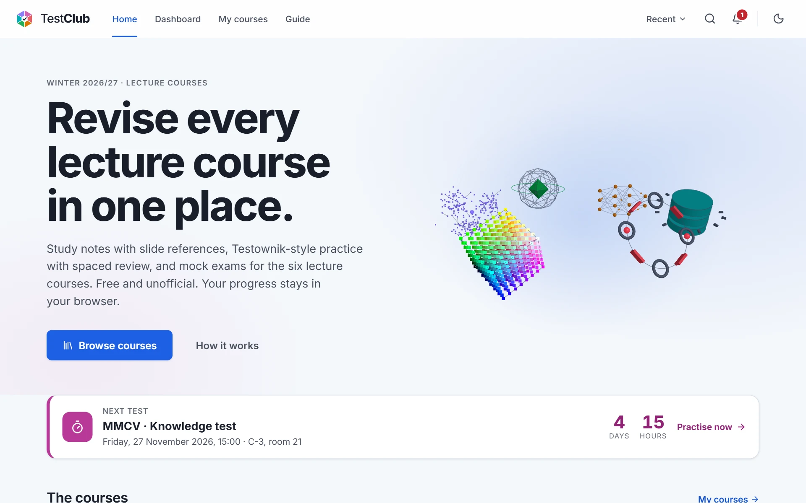
</picture>

## Courses

Each lecture course has its own section and colour. New lectures are added as the semester goes on;
the ones still to come are listed as "Not available yet".

| Code | Course | Covered so far | Questions |
| --- | --- | --- | ---: |
| ADB | Advanced Databases | Lectures 1–5 | 47 (30 open) |
| ISA | Information Systems Analysis | Topics 1–11 | 66 |
| MMCV | Multimedia and Computer Visualization | Lectures 1–7 | 250 |
| NLP | Natural Language Processing | Lectures 1–3 | 37 |
| SSN | Secure Systems and Networks | Lectures 0–4 | 48 |
| SC | Softcomputing | Lectures 1–6 | 79 |

## Using TestClub

### 1. Pick your courses

**My courses** shows every course with its next test and how far you are. Star the courses you take
to keep them together under *Starred*.

<picture>
  <source media="(prefers-color-scheme: dark)" srcset="docs/screenshots/courses-dark.webp">
  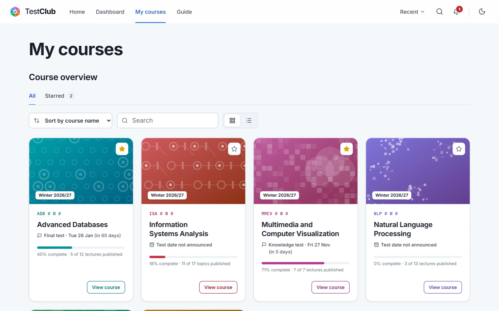
</picture>

### 2. Read the notes beside the slides

Every lecture has key facts, formulas and easy-to-confuse pairs. Each note shows the slide it comes
from; click the thumbnail to open the slide. Points the slides stress are marked *likely on the test*.
Switch to **Flashcards** for a quick self-test of the same lecture.

<picture>
  <source media="(prefers-color-scheme: dark)" srcset="docs/screenshots/lecture-dark.webp">
  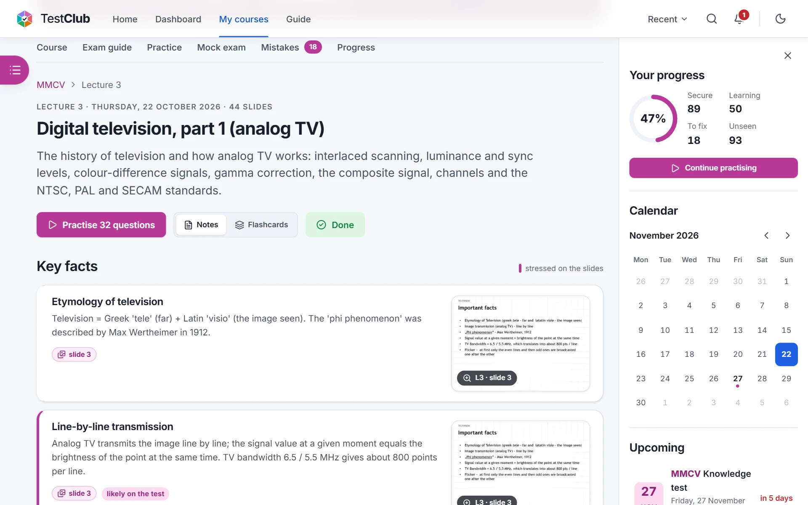
</picture>

### 3. Practise with spaced review

**Today's plan** mixes the questions due for review with enough new ones to cover the course before
the test. A question you answer right, and are sure of, comes back after 1, then 2, then 3 days;
a miss comes back the same day. In a custom drill, the classic Testownik rule applies: a question
stays until you answer it right twice, and every miss adds one more round. Answers helped by a hint
or marked *not sure* never count as known.

After each answer you see the right option, why it is right, and the slide it comes from.
Open questions are graded by you against a model answer: *Missed*, *Partly* or *Got it*.

<picture>
  <source media="(prefers-color-scheme: dark)" srcset="docs/screenshots/practice-dark.webp">
  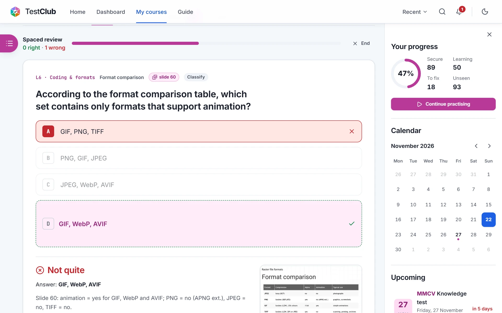
</picture>

### 4. Sit a mock exam

A mock exam draws 10 to 40 questions in proportion to the lectures, favouring the likely ones, with
one minute per question (four for open questions). At the end you get your score, a grade on typical
thresholds, and every question with its explanation and slide.

<picture>
  <source media="(prefers-color-scheme: dark)" srcset="docs/screenshots/mock-dark.webp">
  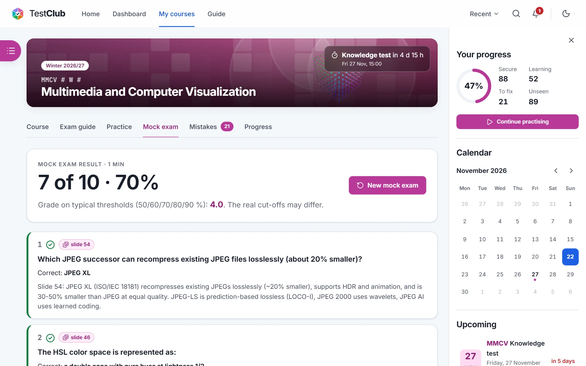
</picture>

### 5. See what is left

**Progress** shows how ready you are, lecture by lecture. **Mistakes** collects every question you
missed, and the **Dashboard** puts all your courses and test dates on one page.

<picture>
  <source media="(prefers-color-scheme: dark)" srcset="docs/screenshots/progress-dark.webp">
  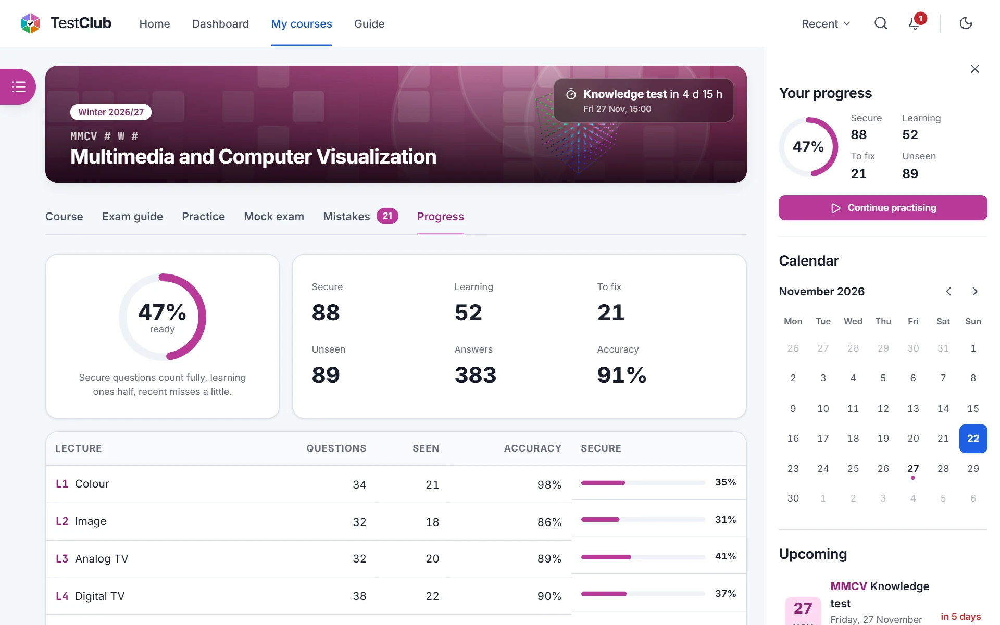
</picture>

### On your phone

Every page works on a small screen, in light and dark mode.

<picture>
  <source media="(prefers-color-scheme: dark)" srcset="docs/screenshots/mobile-dark.webp">
  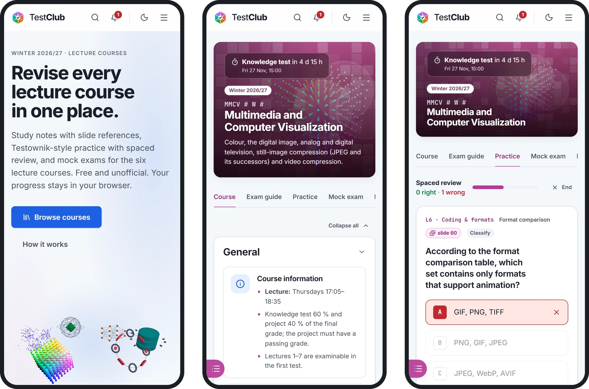
</picture>

<details>
<summary><b>More screenshots</b>: course page, exam guide, flashcards, dashboard, search</summary>
<br>

**Course page**: lecture sections, the course index, your progress, a calendar and upcoming tests.

<picture>
  <source media="(prefers-color-scheme: dark)" srcset="docs/screenshots/course-dark.webp">
  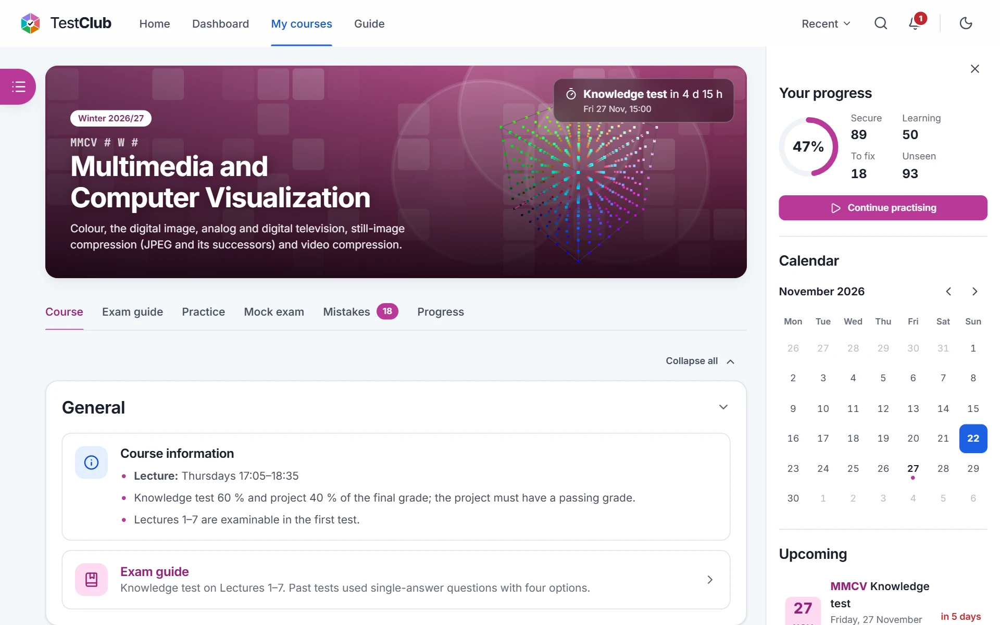
</picture>

**Exam guide**: what the test looks like and what that means for how you revise.

<picture>
  <source media="(prefers-color-scheme: dark)" srcset="docs/screenshots/exam-guide-dark.webp">
  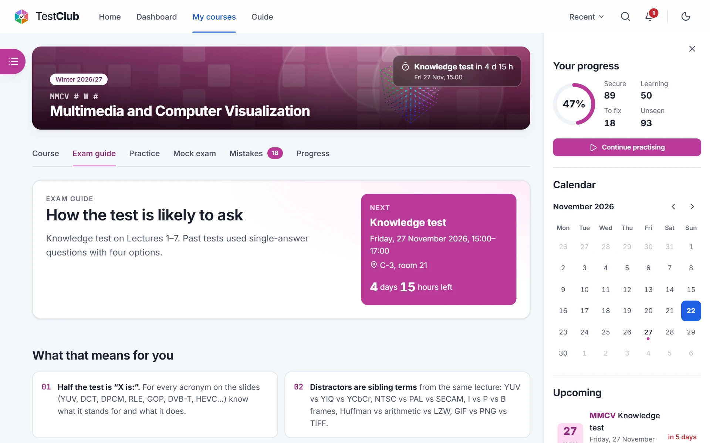
</picture>

**Flashcards**: one card per key fact; flip it, then mark it *Again* or *Got it*.

<picture>
  <source media="(prefers-color-scheme: dark)" srcset="docs/screenshots/flashcards-dark.webp">
  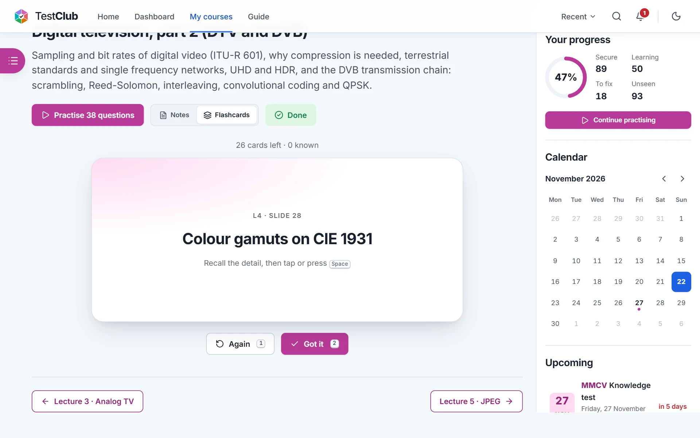
</picture>

**Dashboard**: the timeline of tests and every course at a glance.

<picture>
  <source media="(prefers-color-scheme: dark)" srcset="docs/screenshots/dashboard-dark.webp">
  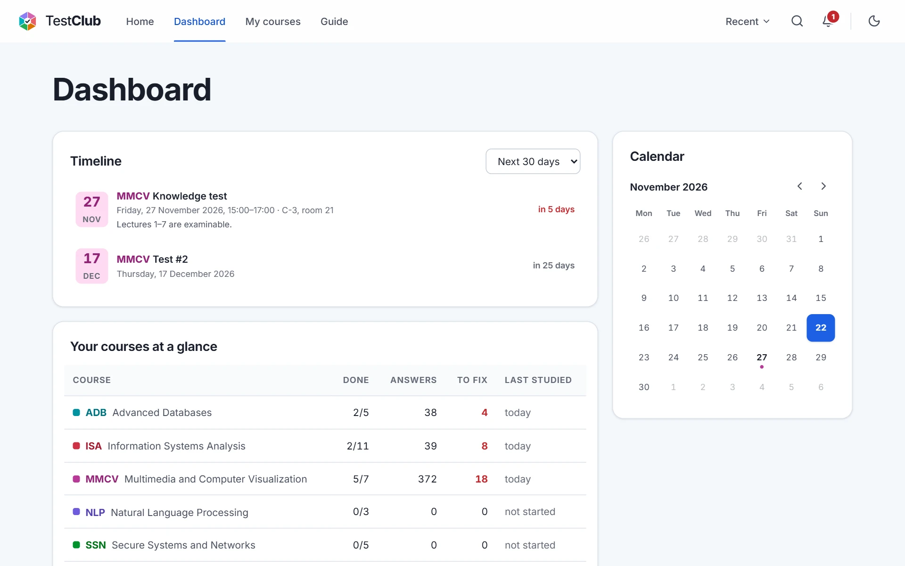
</picture>

**Search**: facts, formulas, mix-ups and questions from every course.

<picture>
  <source media="(prefers-color-scheme: dark)" srcset="docs/screenshots/search-dark.webp">
  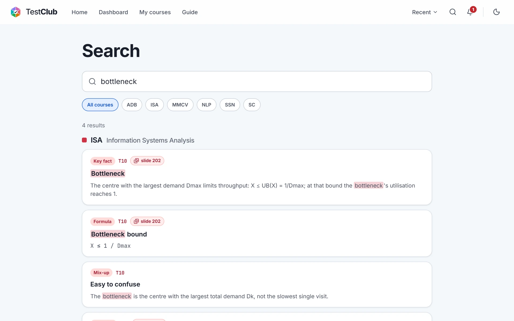
</picture>

</details>

### Keyboard shortcuts

| Key | Action |
| --- | --- |
| <kbd>1</kbd>–<kbd>4</kbd> or <kbd>A</kbd>–<kbd>D</kbd> | Answer a multiple-choice question |
| <kbd>H</kbd> | Show the hint (the answer then counts as helped) |
| <kbd>G</kbd> | Mark your answer as a guess (*not sure*) |
| <kbd>Space</kbd> | Reveal the options (recall mode) or the model answer |
| <kbd>1</kbd> / <kbd>2</kbd> / <kbd>3</kbd> | Grade an open question: missed, partly, got it |
| <kbd>Enter</kbd> or <kbd>→</kbd> | Next question |
| <kbd>←</kbd> <kbd>→</kbd> | Move between questions in a mock exam |
| <kbd>/</kbd> | Search from anywhere |
| <kbd>Esc</kbd> | Close a menu, the course index or a slide |

### Where your progress is kept

TestClub has no accounts. Progress, starred courses and settings are saved in your browser's local
storage, on that device only; clearing the site data resets them. Nothing is sent anywhere: there are
no cookies, no analytics and no requests to other sites.

## Running it locally

You need [Node.js](https://nodejs.org/) 22 or newer.

```bash
git clone https://github.com/abhuiyan00/TestClub.git
cd TestClub
npm ci
npm start
```

The site runs at <http://localhost:4200> and reloads on every change.

| Command | What it does |
| --- | --- |
| `npm start` | Development server with live reload |
| `npm test` | Unit tests (Vitest) in watch mode |
| `npm run check:content` | Checks the content: schema, slide references, option-length balance, privacy rules |
| `npm run build` | Production build in `dist/testclub/browser`, with the Content-Security-Policy and the 404 fallback |
| `npm run check` | Everything CI runs: content check, unit tests and production build |
| `npm run format` | Formats the code with Prettier |

## Project structure

```text
public/
  content/
    catalog.json          courses, lecture lists, test dates, exam guides
    <course>/course.json  study notes and questions
    <course>/slides/      slide snapshots (WebP) referenced by the notes
src/app/
  core/                   data models, spaced review, drill and mock logic, storage
  layout/                 navigation bar and footer
  pages/                  home, dashboard, courses, course tabs, search, guide
  scene/                  Three.js artwork, loaded lazily
  shared/                 cards, calendar, slide viewer, icons
src/styles/               design tokens, base styles, shared UI pieces
tools/
  check-content.mjs       content, quality and privacy checks (run in CI)
  slides.py               renders slide snapshots from local lecture PDFs
  postbuild.mjs           Content-Security-Policy, 404.html fallback, licence notices
docs/screenshots/         images used in this README
.github/                  CI and deployment workflows, issue and pull request templates
```

## Adding material

Everything a course shows comes from `public/content`. To add a lecture, write its notes and questions
in the course's `course.json`, render the slides they reference with `tools/slides.py`, and run
`npm run check:content`. [CONTRIBUTING.md](CONTRIBUTING.md) describes the format, the writing rules
and the privacy rules.

Spotted a wrong answer or a typo? [Open an issue](https://github.com/abhuiyan00/TestClub/issues/new/choose);
the form asks for the course, the lecture and the fix.

## Deployment

The site is a static build and runs on any static host.

- **GitHub Pages:** [`deploy.yml`](.github/workflows/deploy.yml) checks, tests, builds and publishes the
  site on every push to `main`. In the repository settings, set **Pages > Source** to **GitHub Actions**.
  The base path defaults to `/<repository-name>/`; for a custom domain, set the repository variable
  `BASE_HREF` to `/`.
- **Other hosts:** run `npm run build` and upload `dist/testclub/browser`. Serve `404.html` for unknown
  paths (the build includes it) so links to inner pages work.

Search engines are asked not to index the site (`robots.txt` and a `noindex` tag), because it is meant
to be shared by link among students.

## Privacy and security

- No accounts, cookies, trackers or third-party requests. Fonts and icons are bundled.
- A strict Content-Security-Policy is added at build time, and content is always rendered as text, never as HTML.
- Lecture PDFs are never published. Slide snapshots are small crops with header bands, logos and any
  names or hostnames removed.
- `npm run check:content` fails on any e-mail address in the published files. Maintainers also keep a
  hashed list of names outside the repository; CI reads it from the `PRIVACY_DENYLIST` secret when set.

Found personal data or a security problem? See [SECURITY.md](SECURITY.md).

## Built with

[Angular 22](https://angular.dev/) (standalone components, signals, zoneless), TypeScript,
[Three.js](https://threejs.org/), SCSS with OKLCH colour tokens, [Vitest](https://vitest.dev/),
self-hosted Inter and JetBrains Mono, and a small Python tool ([PyMuPDF](https://pymupdf.readthedocs.io/),
Pillow) for slide snapshots.

## License

The code is released under the [MIT License](LICENSE). Slide excerpts remain the property of their
authors and appear in small parts for study reference only.

TestClub is an independent student project. It is not affiliated with the university or its course portal.
